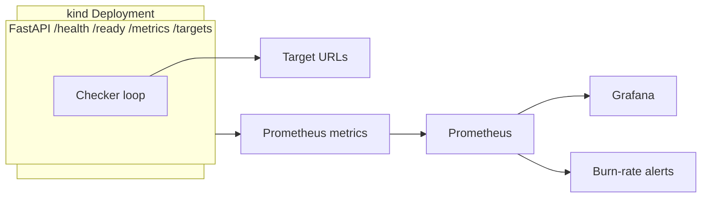
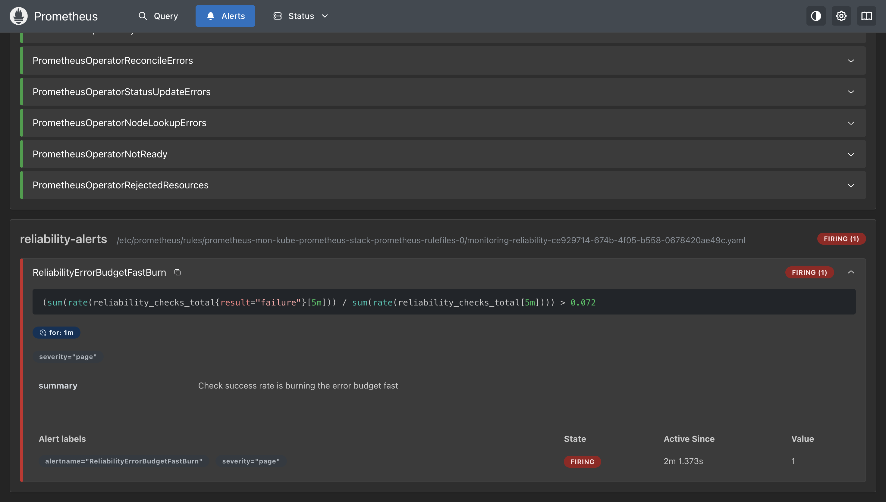

# reliability-lab

A small URL monitor run like a production system: checks, SLOs, burn-rate alerts, and failure drills.

Status: drills were run on a kind cluster (2026-11-14). No AWS resources have been created.

## What it does

- Checks a list of URLs on an interval.
- Records status code, latency, and success or failure.
- Exposes `/health`, `/ready`, `/metrics`, and `/targets`.
- Defines two SLOs and burn-rate alerts before the service was built.

## Architecture




## Quickstart

```bash
git clone https://github.com/dardan-hoxhaj/reliability-lab.git
cd reliability-lab
python3 -m venv .venv && source .venv/bin/activate
pip install -r requirements-dev.txt
make test
```

On a machine with Docker and kind:

```bash
make up
make deploy
make demo
```

## Measured results

| Item | Result |
|---|---|
| pytest | 10 passed, 82% coverage (local, 2026-11-14) |
| ruff | clean |
| promtool check rules | 6 rules, success |
| promtool test rules | success |
| kubeconform | valid (CRDs skipped with -ignore-missing-schemas) |
| terraform validate | success |
| drills | pod kill 6s, bad deploy 45s, hey 7264/7264 at 242 req/s (p95 131ms) |
| image size | 218MB (`reliability-lab:local`, 2026-11-14) |
| burn-rate alert | fired at 01:10 ET, inactive at 01:19 ET after fix (2026-11-14) |

## Limitations

- Terraform is validate-only. No `terraform apply`. No remote state.
- kind, not EKS. CI does not deploy on `main`.
- Image is 218MB. A multi-stage build would shrink it; not done in this pass.
- The load test did not burn the error budget (all requests succeeded). The burn-rate alert was proven separately with a failing target: ReliabilityErrorBudgetFastBurn fired and recovered (see docs/drills/README.md).
- Grafana screenshot is in `docs/drills/grafana-dashboard.png`.



[Grafana dashboard](docs/drills/grafana-dashboard.png) · [Alert recovered](docs/drills/alert-recovered.png)

## Cost

No AWS resources are created by this repo as committed. If you apply the Terraform, the billing alarm defaults to $10. Tear down with `terraform destroy` after screenshots.
