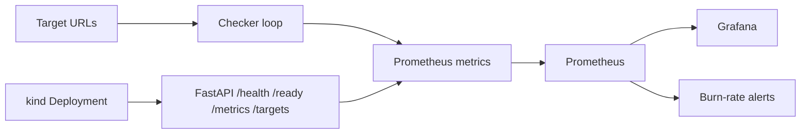

# reliability-lab

A small URL monitor run like a production system: checks, SLOs, burn-rate alerts, and failure drills.

Status: code, tests, CI, and manifests are written. Drills have not been run (this build environment has no Docker). No AWS resources have been created.

## What it does

- Checks a list of URLs on an interval.
- Records status code, latency, and success or failure.
- Exposes `/health`, `/ready`, `/metrics`, and `/targets`.
- Defines two SLOs and burn-rate alerts before the service was built.

## Architecture




## Quickstart

```bash
git clone https://github.com/dardan-hoxhaj/reliability-lab.git
cd reliability-lab
python3 -m venv .venv && source .venv/bin/activate
pip install -r requirements-dev.txt
make test
```

On a machine with Docker and kind:

```bash
make up
make deploy
make demo
```

## Measured results

| Item | Result |
|---|---|
| pytest | 10 passed, 82% coverage (local, 2026-11-14) |
| ruff | clean |
| promtool check rules | 6 rules, success |
| promtool test rules | success |
| kubeconform | 6/6 valid |
| terraform validate | success |
| drills | pod kill 6s, bad deploy 45s, load 100/100 at 2-8ms (2026-11-14) |
| image size | 218MB (`reliability-lab:local`, 2026-11-14) |
| AWS | not applied |

## Limitations

- Drills are scripted but not executed. Numbers will be filled in after a laptop run.
- Terraform is validate-only. No `terraform apply`.
- kind, not EKS.
- Image is 218MB. A multi-stage build would shrink it; not done in this pass.

## Cost

No AWS resources are created by this repo as committed. If you apply the Terraform, the billing alarm defaults to $10. Tear down with `terraform destroy` after screenshots.
