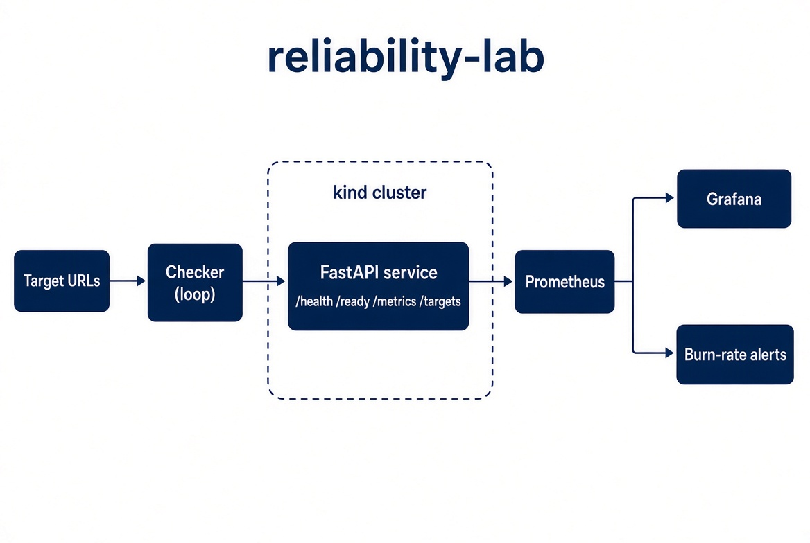
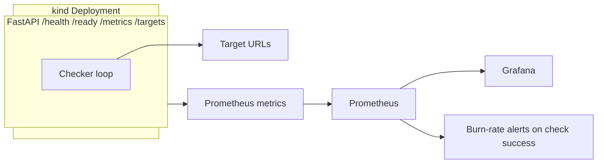

# reliability-lab

[](https://github.com/dardan-hoxhaj/reliability-lab/actions/workflows/ci.yml?query=branch%3Amain)

A small URL monitor run like a production system: checks, SLOs, burn-rate alerts, and failure drills.

Status: drills were run on a kind cluster (2026-11-14). No AWS resources have been created.

## What it does

- Checks a list of URLs on an interval.
- Records status code, latency, and success or failure.
- Exposes `/health`, `/ready`, `/metrics`, and `/targets`.
- Defines two SLOs (check success and request latency) before the service was built. See [docs/SLO.md](docs/SLO.md).
- Multi-window burn-rate alerts (fast and slow) on the check-success SLO. The latency SLO is tracked by a recording rule and a dashboard panel, without a burn-rate alert.

## Architecture





## Quickstart

Unit tests and rule checks, no cluster needed:

```bash
git clone https://github.com/dardan-hoxhaj/reliability-lab.git
cd reliability-lab
python3 -m venv .venv && source .venv/bin/activate
pip install -r requirements-dev.txt
make test
```

On a machine with Docker, kind, kubectl, and helm:

```bash
make up        # kind cluster + kube-prometheus-stack (release "mon", namespace "monitoring") + Grafana dashboard
make deploy    # build image, load into kind, apply k8s/namespace.yaml then k8s/
make demo      # port-forward and curl /health, /targets, /metrics
make metrics-server   # optional: lets the HPA read CPU (kind does not ship metrics-server)
```

How the pieces connect:

- `make up` installs kube-prometheus-stack with Helm before any app manifests are applied, so the `ServiceMonitor` and `PrometheusRule` CRDs exist when `make deploy` runs.
- The chart's Prometheus selects ServiceMonitors and PrometheusRules labelled `release: mon` in any namespace. Both objects in `k8s/` carry that label.
- `make dashboard` (part of `make up`) loads `observability/grafana-dashboard.json` as a ConfigMap labelled `grafana_dashboard=1` in the `monitoring` namespace. The chart's Grafana sidecar imports it as the `reliability-lab` dashboard.
- Grafana: `kubectl -n monitoring port-forward svc/mon-grafana 3000:80`. Prometheus: `kubectl -n monitoring port-forward svc/mon-kube-prometheus-stack-prometheus 9090`.

## Measured results

| Item | Result |
|---|---|
| pytest | 15 passed, 82% coverage (local, 2026-11-14) |
| ruff | clean |
| promtool check rules | 6 rules, success |
| promtool test rules | success (fast burn, slow burn, no-burn, crash loop, burn-rate recording rule) |
| kubeconform | 6 valid, 0 invalid; 2 CRD objects (ServiceMonitor, PrometheusRule) skipped with -ignore-missing-schemas |
| terraform validate | success |
| drills | pod kill: replacement Ready in 6s; bad deploy: undone 45s after the bad image was set (mostly the script's own waits); hey 7264/7264 at 242 req/s (p95 131ms) |
| image size | 218MB (`reliability-lab:local`, 2026-11-14) |
| burn-rate drill | simplified single-window fast-burn rule fired at 01:10 ET, inactive at 01:19 ET after fix (2026-11-14) |

## Alert drill

The live drill pointed the checker at a URL that always returns 500. It used a **simplified single-window version** of the fast-burn rule (5m failure ratio > 7.2%, `for: 1m`), not the committed multi-window rule (5m and 1h, `for: 2m`). The committed rules are verified by the promtool unit tests in `observability/alert-tests.yaml`. Timeline and details: [docs/drills/README.md](docs/drills/README.md).


[Grafana dashboard](docs/drills/grafana-dashboard.png) · [Alert recovered](docs/drills/alert-recovered.png) · [Pod-kill postmortem](docs/postmortems/drill-podkill.md) · [Runbook](docs/RUNBOOK.md)

## Limitations

- The live alert drill used a simplified single-window fast-burn rule. A re-run with the committed multi-window rule is pending.
- The Quickstart cluster steps (`make up`, Helm install, dashboard ConfigMap, apply ordering, `make metrics-server`) were updated after the drills and have not been re-run end to end since.
- The HPA needs metrics-server, which kind does not include by default. Without `make metrics-server`, the HPA reports unknown CPU and stays at 2 replicas.
- The latency SLO has no burn-rate alert, only a recording rule and dashboard panel.
- Terraform is validate-only. No `terraform apply`. No remote state.
- kind, not EKS. CI does not deploy on `main`.
- Image is 218MB. A multi-stage build would shrink it; not done in this pass.
- The load test did not burn the error budget (all requests succeeded), so the alert drill used a failing target instead.
- The Grafana screenshot shows the third panel's old label, "Error budget remaining". That panel is now "Error budget burn rate (5m, 1 = on budget)"; see docs/drills/README.md.

## Cost

No AWS resources are created by this repo as committed. If you apply the Terraform, it creates an ECR repository, an IAM role for GitHub Actions OIDC (the account must already have the `token.actions.githubusercontent.com` OIDC provider; the module does not create it), an SNS topic, and a billing alarm (default $10) that notifies the topic. Set `billing_alert_email` to receive the alarm by email (AWS sends a confirmation link), or to `""` to skip the subscription. Tear down with `terraform destroy`.
