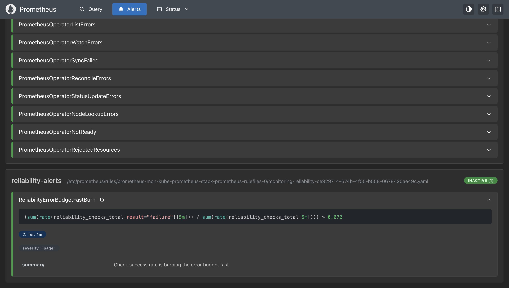

# Drills

Run on a laptop (kind, 2026-11-14).

## Pod kill

- Detect: immediate (pod deleted by the script)
- Recover: **6s** (`kubectl rollout status` returned)

## Bad deploy

- Bad image set at 05:09:02 UTC
- Rollout timed out (expected: the new pods never became ready)
- Undo complete at 05:09:47 UTC
- Recover: **45s**

## Overload

- Tool: `hey -z 30s -c 20` against `/health` (2026-11-14)
- Result: 7264 requests, all HTTP 200, 241.6 req/s
- Latency: average 83 ms, p95 131 ms, slowest 260 ms
- Burn-rate alert: did not fire. Every request succeeded, so the error budget was not burned. That is the correct outcome for a healthy service under load.

## Grafana (same session)

Dashboard `reliability-lab` after Prometheus scrape:

- Check success rate (5m): 1
- HTTP latency p95 (5m): 0.0095 s
- "Error budget remaining": 1
- Pod restarts (15m): 0

The third panel was labelled "Error budget remaining" at the time, and the screenshot still shows that label. It actually computed 1 minus the 5-minute burn rate, so 1 only meant "no failed checks in the last 5 minutes", not "the whole 30-day budget is left". It has since been renamed to "Error budget burn rate (5m, 1 = on budget)" and now shows the burn rate directly (0 for the same data). See `docs/SLO.md`.

## Error-budget burn (alert fired and recovered)

**Rule used in this drill:** a simplified, single-window version of the fast-burn rule, loaded as a separate PrometheusRule in the `monitoring` namespace: failure ratio over 5m > 0.072 (14.4 × 0.5%), `for: 1m`. It kept the alert name `ReliabilityErrorBudgetFastBurn`. The committed rule in `observability/alert-rules.yaml` and `k8s/prometheusrule.yaml` is multi-window (5m **and** 1h, `for: 2m`). The committed rule was not the one that fired here; its behaviour is verified by the promtool unit tests in `observability/alert-tests.yaml`. A re-run of this drill with the committed rule is pending.

- 00:53 ET: `TARGETS` set to `https://httpbin.org/status/500`. Checks returned `status_500`.
- 01:10 ET: the simplified `ReliabilityErrorBudgetFastBurn` rule was FIRING in Prometheus (value 1: 100% of checks failed over the 5m window).
- 01:14 ET: `TARGETS` set back to `https://example.com`. Deployment rolled out.
- 01:19 ET: the same alert was INACTIVE.

## Known gaps

- The load test did not fire an alert. A healthy service under load should not. The burn alert was exercised with a failing target instead.
- The live burn drill used the simplified single-window rule described above, not the committed multi-window rule. Re-running it with the committed rule is pending.