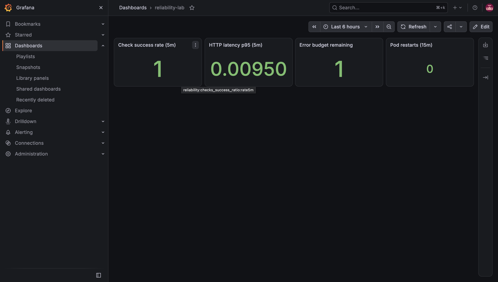
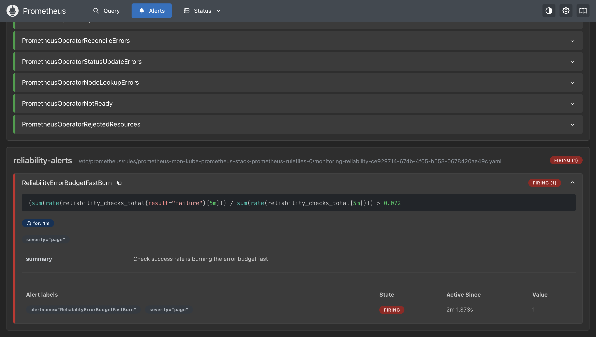

# Drills

Run on a laptop (kind, 2026-11-14).

## Pod kill

- Detect: immediate (pod deleted by the script)
- Recover: **6s** (`kubectl rollout status` returned)

## Bad deploy

- Bad image set at 05:09:02 UTC
- Rollout timed out (expected: the new pods never became ready)
- Undo complete at 05:09:47 UTC
- Recover: **45s**

## Overload

- Tool: `hey -z 30s -c 20` against `/health` (2026-11-14)
- Result: 7264 requests, all HTTP 200, 241.6 req/s
- Latency: average 83 ms, p95 131 ms, slowest 260 ms
- Burn-rate alert: did not fire. Every request succeeded, so the error budget was not burned. That is the correct outcome for a healthy service under load.

## Grafana (same session)

Dashboard `reliability-lab` after Prometheus scrape:

- Check success rate (5m): 1
- HTTP latency p95 (5m): 0.0095 s
- Error budget remaining: 1
- Pod restarts (15m): 0

## Error-budget burn (alert fired and recovered)

- 00:53 ET: `TARGETS` set to `https://httpbin.org/status/500`. Checks returned `status_500`.
- 01:10 ET: `ReliabilityErrorBudgetFastBurn` was FIRING in Prometheus (value 1, failure rate over the 5m window).
- 01:14 ET: `TARGETS` set back to `https://example.com`. Deployment rolled out.
- 01:19 ET: the same alert was INACTIVE.

## Honest gaps

- The load test did not fire an alert. A healthy service under load should not. The burn alert was proved with a failing target instead.